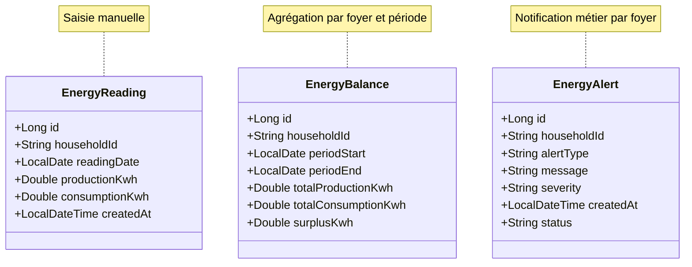

# Microservice 2 — Energy Monitoring Service
## Conception métier et modèle PostgreSQL

**Projet :** EnergyShare  
**Base de données :** PostgreSQL, dédiée au microservice 2 (nom proposé : `energy_monitoring_db`)  
**Persistance :** Spring Data JPA / Hibernate  
**Statut :** conception de la base et règles métier — non garantie d'implémentation

## 1. Contexte et limites fonctionnelles

Monitoring assure la **saisie manuelle** des relevés d'énergie par foyer, le calcul des bilans de production/consommation, l'historique et les alertes. Il ne gère ni les offres ni les réservations, ni les paiements, ni l'authentification. La propriété des foyers appartient à **User & Household Service**.

La donnée énergétique est **déclarative** : aucun équipement IoT, compteur intelligent ou transfert physique d'électricité n'est pris en charge dans le périmètre de ce prototype.

## 2. Entités métier retenues

### 2.1 `EnergyReading`

| Champ Java | Type Java | Colonne PostgreSQL | Contraintes |
|---|---|---|---|
| `id` | `Long` | `id` | PK, identity |
| `householdId` | `String` | `household_id` | `NOT NULL` |
| `readingDate` | `LocalDate` | `reading_date` | `NOT NULL` |
| `productionKwh` | `Double` | `production_kwh` | `NOT NULL`, `>= 0` |
| `consumptionKwh` | `Double` | `consumption_kwh` | `NOT NULL`, `>= 0` |
| `createdAt` | `LocalDateTime` | `created_at` | `NOT NULL` |

**Règle proposée :** un relevé par foyer et par jour ; contrainte unique `(household_id, reading_date)` pour éviter les doublons.

### 2.2 `EnergyBalance`

| Champ Java | Type Java | Colonne PostgreSQL | Contraintes |
|---|---|---|---|
| `id` | `Long` | `id` | PK, identity |
| `householdId` | `String` | `household_id` | `NOT NULL` |
| `periodStart` | `LocalDate` | `period_start` | `NOT NULL` |
| `periodEnd` | `LocalDate` | `period_end` | `NOT NULL`, `>= period_start` |
| `totalProductionKwh` | `Double` | `total_production_kwh` | `NOT NULL`, `>= 0` |
| `totalConsumptionKwh` | `Double` | `total_consumption_kwh` | `NOT NULL`, `>= 0` |
| `surplusKwh` | `Double` | `surplus_kwh` | `NOT NULL`, `>= 0` |

Les bilans peuvent être **matérialisés** dans cette table, ou calculés à la demande. Le SQL ci-dessous suit l'option **matérialisée** ; l'équipe doit définir comment les rafraîchir lors d'un changement de relevé.

### 2.3 `EnergyAlert`

| Champ Java | Type Java | Colonne PostgreSQL | Contraintes |
|---|---|---|---|
| `id` | `Long` | `id` | PK, identity |
| `householdId` | `String` | `household_id` | `NOT NULL` |
| `alertType` | `String` | `alert_type` | `NOT NULL` |
| `message` | `String` | `message` | `NOT NULL` |
| `severity` | `String` | `severity` | `NOT NULL` |
| `createdAt` | `LocalDateTime` | `created_at` | `NOT NULL` |
| `status` | `String` | `status` | `NOT NULL` |

**Types d'alertes proposés :** `HIGH_CONSUMPTION`, `SURPLUS_AVAILABLE`, `MISSING_READING`. **Niveaux :** `INFO`, `WARNING`, `CRITICAL`. **États :** `UNREAD`, `READ`, `ARCHIVED`. Leur génération doit reposer sur des seuils et critères documentés, et ne pas se déclencher sans données suffisantes.

## 3. Diagramme conceptuel simplifié

Les trois entités sont liées au **même identifiant externe de foyer**, sans clé étrangère locale vers Household :



**Remarque :** ce diagramme exprime un lien **logique**, pas des clés étrangères JPA entre les tables : la cohérence des références au foyer et la relation avec Household sont gérées via API et règles applicatives.

## 4. Schéma PostgreSQL proposé

```sql
CREATE TABLE energy_readings (
    id BIGINT GENERATED BY DEFAULT AS IDENTITY PRIMARY KEY,
    household_id VARCHAR(100) NOT NULL,
    reading_date DATE NOT NULL,
    production_kwh DOUBLE PRECISION NOT NULL CHECK (production_kwh >= 0 AND isfinite(production_kwh)),
    consumption_kwh DOUBLE PRECISION NOT NULL CHECK (consumption_kwh >= 0 AND isfinite(consumption_kwh)),
    created_at TIMESTAMP WITHOUT TIME ZONE NOT NULL DEFAULT CURRENT_TIMESTAMP,
    CONSTRAINT uq_energy_reading_household_date UNIQUE (household_id, reading_date)
);

CREATE TABLE energy_balances (
    id BIGINT GENERATED BY DEFAULT AS IDENTITY PRIMARY KEY,
    household_id VARCHAR(100) NOT NULL,
    period_start DATE NOT NULL,
    period_end DATE NOT NULL,
    total_production_kwh DOUBLE PRECISION NOT NULL CHECK (total_production_kwh >= 0 AND isfinite(total_production_kwh)),
    total_consumption_kwh DOUBLE PRECISION NOT NULL CHECK (total_consumption_kwh >= 0 AND isfinite(total_consumption_kwh)),
    surplus_kwh DOUBLE PRECISION NOT NULL CHECK (surplus_kwh >= 0 AND isfinite(surplus_kwh)),
    CONSTRAINT ck_balance_period CHECK (period_start <= period_end),
    CONSTRAINT uq_balance_household_period UNIQUE (household_id, period_start, period_end)
);

CREATE TABLE energy_alerts (
    id BIGINT GENERATED BY DEFAULT AS IDENTITY PRIMARY KEY,
    household_id VARCHAR(100) NOT NULL,
    alert_type VARCHAR(50) NOT NULL,
    message TEXT NOT NULL,
    severity VARCHAR(20) NOT NULL CHECK (severity IN ('INFO', 'WARNING', 'CRITICAL')),
    created_at TIMESTAMP WITHOUT TIME ZONE NOT NULL DEFAULT CURRENT_TIMESTAMP,
    status VARCHAR(20) NOT NULL DEFAULT 'UNREAD'
        CHECK (status IN ('UNREAD', 'READ', 'ARCHIVED'))
);

CREATE INDEX idx_readings_household_date
    ON energy_readings (household_id, reading_date DESC);

CREATE INDEX idx_balances_household_period
    ON energy_balances (household_id, period_start, period_end);

CREATE INDEX idx_alerts_household_status_date
    ON energy_alerts (household_id, status, created_at DESC);
```

### Notes d'implémentation

- Utiliser Flyway ou Liquibase pour versionner les migrations ; ne pas dépendre uniquement de `hibernate.hbm2ddl.auto=update` en équipe.
- Avec `Double`, de légers écarts d'arrondi sont possibles ; définir une politique d'affichage/arrondi du kWh. Pour une exactitude décimale stricte, envisager `BigDecimal`/`NUMERIC`, ce qui constituerait **un changement du modèle Java actuellement retenu**.
- `LocalDateTime` et `TIMESTAMP WITHOUT TIME ZONE` nécessitent une convention explicite (par exemple stockage logique en UTC) ; ne pas confondre ce champ avec un instant portant un décalage horaire.
- `isfinite()` est une fonction PostgreSQL pour rejeter les valeurs non finies dans les contraintes des doubles.
- Les chaînes de valeurs `alertType` sont définies dans l'application (ou dans une contrainte SQL additionnelle lorsque stabilisées).

## 5. Calcul du bilan et du surplus

Sur une période inclusive `[periodStart, periodEnd]` :

```text
totalProductionKwh  = somme des productionKwh
                       des relevés du foyer sur la période
totalConsumptionKwh = somme des consumptionKwh
                       des relevés du foyer sur la période
soldeNetKwh         = totalProductionKwh - totalConsumptionKwh
surplusKwh          = max(soldeNetKwh, 0)
```

Exemples :

| Production | Consommation | Solde net | Surplus théorique |
|---:|---:|---:|---:|
| 20 kWh | 12 kWh | +8 kWh | 8 kWh |
| 7 kWh | 12 kWh | −5 kWh | 0 kWh |
| 0 kWh | 0 kWh | 0 kWh | 0 kWh |

Une période **sans relevé** doit être distinguée d'une période dont les relevés déclarent zéro production et zéro consommation. Le comportement de l'API doit être documenté (absence de données plutôt que fausse mesure nulle).

### Exemple de requête SQL d'agrégation

```sql
SELECT
    household_id,
    COALESCE(SUM(production_kwh), 0) AS total_production_kwh,
    COALESCE(SUM(consumption_kwh), 0) AS total_consumption_kwh,
    GREATEST(
        COALESCE(SUM(production_kwh), 0)
        - COALESCE(SUM(consumption_kwh), 0),
        0
    ) AS surplus_kwh,
    COUNT(*) AS reading_count
FROM energy_readings
WHERE household_id = :household_id
  AND reading_date BETWEEN :period_start AND :period_end
GROUP BY household_id;
```

Si aucun relevé ne correspond, la requête ne renvoie **aucune ligne** (ce qui permet de distinguer « aucune donnée » de « zéro déclaré »).

## 6. Règles de gestion

1. **Propriété du foyer :** `householdId` doit correspondre à un foyer valide et accessible au demandeur ; la vérification est effectuée via l'intégration Household, sans lecture de sa base.
2. **Unicité journalière :** un `(householdId, readingDate)` unique ; une correction utilise `PUT` sur le relevé existant.
3. **Validation :** dates cohérentes, quantités non négatives et finies ; contrôler les limites des saisies.
4. **Cohérence des bilans :** une création, mise à jour ou suppression de relevé invalide/recalcule tous les bilans matérialisés couvrant cette date.
5. **Alertes :** émission selon règles métiers configurables (seuils et disponibilité de données) ; gérer le risque de doublon lors du recalcul.
6. **Accès interservices :** le Marketplace peut consulter le surplus déclaré sur la période ; il ne modifie pas les relevés et ne gère pas les bilans.
7. **Limite temporelle :** un surplus journalier calculé n'implique pas qu'il soit physiquement disponible à une heure donnée.
8. **Aucune garantie physique :** le service fournit de l'information déclarative pour une simulation de partage d'énergie.

## 7. Exemples de repositories JPA (conception)

```java
public interface EnergyReadingRepository
        extends JpaRepository<EnergyReading, Long> {

    Optional<EnergyReading> findByHouseholdIdAndReadingDate(
        String householdId, LocalDate readingDate);

    List<EnergyReading> findByHouseholdIdAndReadingDateBetweenOrderByReadingDateAsc(
        String householdId, LocalDate from, LocalDate to);
}
```

```java
public interface EnergyBalanceRepository
        extends JpaRepository<EnergyBalance, Long> {

    Optional<EnergyBalance> findByHouseholdIdAndPeriodStartAndPeriodEnd(
        String householdId, LocalDate start, LocalDate end);
}
```

```java
public interface EnergyAlertRepository
        extends JpaRepository<EnergyAlert, Long> {

    List<EnergyAlert> findByHouseholdIdAndStatusOrderByCreatedAtDesc(
        String householdId, String status);
}
```

Ces signatures sont **illustratives** et supposent que les noms des attributs JPA restent conformes aux trois entités ci-dessus.

## 8. Tests de conception et de persistance

| Test | Résultat attendu |
|---|---|
| Insérer un relevé valide | Identifiant généré et champs persistés |
| Insérer un relevé identique foyer/date | Violation d'unicité / réponse API `409` |
| Production ou consommation négative | Rejet de validation et de contrainte SQL |
| Relevé avec `NaN`/infini | Rejet par validation/contrainte SQL |
| Période de bilan inversée | Rejet |
| Somme : 20 − 12 kWh | Surplus de 8 kWh |
| Somme : 7 − 12 kWh | Surplus de 0 kWh |
| Correction d'un relevé | Bilan matérialisé synchronisé ou invalidé |
| Aucune lecture durant la période | Indicateur d'absence de données, pas un zéro fictif |
| Consultation foyer non autorisé | Accès refusé |

## 9. Évolutions envisageables (hors périmètre actuel)

- Ingestion de mesures de capteurs IoT et granularité horaire.
- Contrôle qualité des relevés et détection de valeurs aberrantes.
- Historisation des corrections / journal d'audit.
- Projections et prévisions énergétiques fondées sur des séries temporelles réelles.

Ces évolutions **ne font pas partie des trois entités et du périmètre actuels** du Monitoring.
