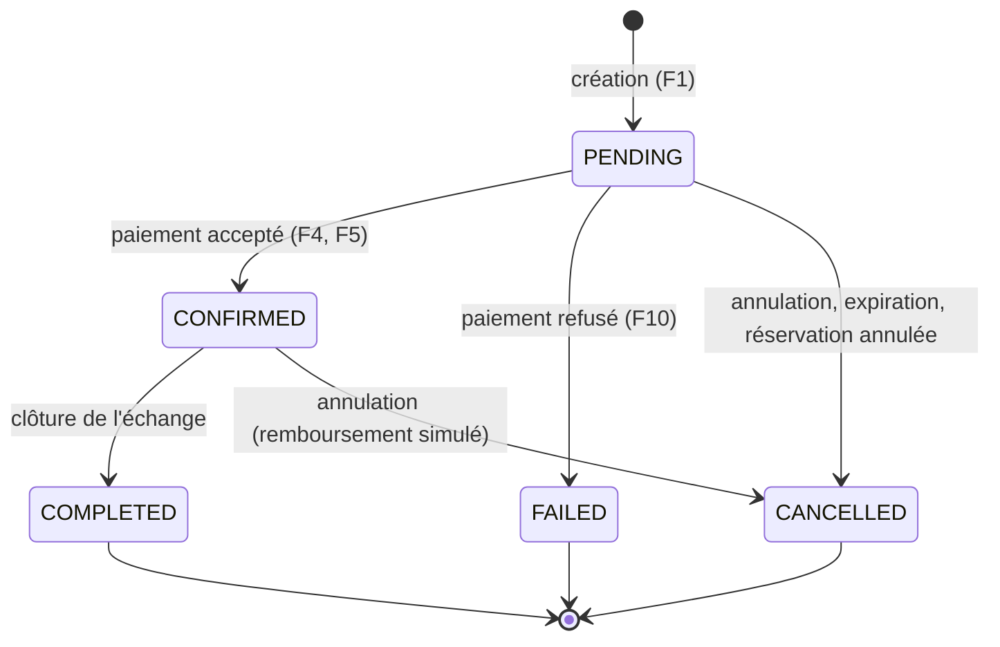

# Energy Transaction Service — Modèle de données et règles métier

> **Remarque :** ce fichier garde le nom `mongodb-business-rules.md` pour rester cohérent avec le livrable du Marketplace Service. Le Transaction Service utilise en réalité **PostgreSQL**, comme décrit ci-dessous.

## 1. Choix de la base de données

Le Transaction Service gère de l'argent (même simulé) et des changements d'état qui doivent rester cohérents entre eux : une transaction, son paiement et son historique doivent évoluer ensemble ou pas du tout. Nous avons donc choisi **PostgreSQL** pour :

- ses garanties **ACID**, qui permettent de modifier la transaction, d'enregistrer le paiement et d'écrire l'historique dans une seule transaction de base de données ;
- ses **contraintes d'intégrité** (clés étrangères, unicité, `CHECK`), qui protègent les règles métier même en cas de bug applicatif ou de requêtes concurrentes ;
- le type **`NUMERIC`**, exact, adapté aux montants et aux quantités ;
- des données naturellement **relationnelles** (une transaction, ses paiements, son historique).

Principes :
- Chaque microservice possède sa propre base. `transaction_db` n'est jamais lue ni modifiée par un autre service, et le Transaction Service n'accède jamais aux bases des autres.
- Les identifiants venant d'autres services (`reservation_id`, `seller_household_id`, `buyer_household_id`) sont des **références opaques** stockées en texte, **sans clé étrangère** : le Transaction Service ne dépend pas de la façon dont le Marketplace ou le User Service stockent leurs identifiants.
- En Java, les montants et quantités sont des `BigDecimal` et les dates des `Instant` (UTC) ; jamais de `double` pour de l'argent.

**Nom de la base :** `transaction_db`

## 2. Modèle de données

Relations : une `energy_transactions` possède 0 à N `payments` (une seule tentative autorisée dans cette version, voir R6) et 1 à N lignes de `transaction_history` (au minimum la ligne de création).

### 2.1 Table `energy_transactions`

| Colonne | Type | Contraintes | Description |
|---|---|---|---|
| `id` | BIGSERIAL | PK | Identifiant de la transaction |
| `reservation_id` | VARCHAR(64) | NOT NULL, **UNIQUE** | Réservation d'origine (Marketplace) |
| `seller_household_id` | VARCHAR(64) | NOT NULL | Foyer vendeur |
| `buyer_household_id` | VARCHAR(64) | NOT NULL, différent du vendeur (`CHECK`) | Foyer acheteur |
| `quantity_kwh` | NUMERIC(10,3) | NOT NULL, `> 0` | Quantité échangée, copiée de la réservation |
| `unit_price` | NUMERIC(10,4) | NOT NULL, `>= 0` | Prix par kWh, copié de la réservation |
| `total_amount` | NUMERIC(12,2) | NOT NULL, `>= 0` | Montant total calculé |
| `status` | VARCHAR(20) | NOT NULL, `CHECK` sur les valeurs autorisées | Statut courant |
| `created_at` | TIMESTAMPTZ | NOT NULL | Date de création |
| `completed_at` | TIMESTAMPTZ | NULL | Date de clôture (renseignée seulement si `COMPLETED`) |
| `cancellation_reason` | VARCHAR(255) | NULL | Motif d'annulation ou d'échec |
| `version` | BIGINT | NOT NULL | Verrou optimiste (`@Version` JPA) |

Index : `(buyer_household_id, created_at DESC)`, `(seller_household_id, created_at DESC)`, `(status, created_at)` (liste, filtres, tâche d'expiration).

### 2.2 Table `payments`

| Colonne | Type | Contraintes | Description |
|---|---|---|---|
| `id` | BIGSERIAL | PK | Identifiant du paiement |
| `transaction_id` | BIGINT | NOT NULL, FK → `energy_transactions(id)` | Transaction payée |
| `amount` | NUMERIC(12,2) | NOT NULL, `> 0` | Montant (égal à `total_amount`) |
| `payment_method` | VARCHAR(20) | NOT NULL | `SIMULATED`, `CREDIT_CARD`, `BANK_TRANSFER` |
| `payment_status` | VARCHAR(20) | NOT NULL | `PENDING`, `SUCCESS`, `FAILED`, `REFUNDED` |
| `payment_reference` | VARCHAR(100) | UNIQUE, NULL | Référence (ex. `SIM-20261109-000001`) |
| `payment_date` | TIMESTAMPTZ | NULL | Date du traitement du paiement |

Contrainte supplémentaire : un **index unique partiel** sur `transaction_id` pour les lignes `payment_status = 'SUCCESS'`, qui rend impossible deux paiements réussis pour une même transaction, même sous requêtes concurrentes.

Seule la méthode `SIMULATED` est utilisée dans cette version ; les deux autres existent pour une évolution future. `REFUNDED` représente le remboursement simulé d'une transaction annulée après paiement.

### 2.3 Table `transaction_history`

| Colonne | Type | Contraintes | Description |
|---|---|---|---|
| `id` | BIGSERIAL | PK | Identifiant de la ligne |
| `transaction_id` | BIGINT | NOT NULL, FK → `energy_transactions(id)` | Transaction concernée |
| `previous_status` | VARCHAR(20) | NULL | Ancien statut (`NULL` à la création) |
| `new_status` | VARCHAR(20) | NOT NULL | Nouveau statut |
| `description` | VARCHAR(255) | NOT NULL | Explication (acteur, référence de paiement, commentaire…) |
| `changed_at` | TIMESTAMPTZ | NOT NULL | Date du changement |

Index : `(transaction_id, changed_at)`. Cette table est **en ajout seul** : aucune ligne n'est modifiée ni supprimée.

### 2.4 Tables techniques (fiabilité des événements)

Ces deux tables ne sont pas des entités métier ; elles servent à la communication asynchrone (voir `events-rabbitmq.md`).

| Table | Colonnes principales | Rôle |
|---|---|---|
| `outbox_events` | `id` (UUID, PK), `aggregate_id`, `event_type`, `routing_key`, `payload` (JSONB), `created_at`, `published_at` (NULL tant que non publié) | Événements à publier, écrits dans la même transaction que le changement de statut |
| `processed_events` | `event_id` (UUID, PK), `processed_at` | Identifiants des événements reçus et déjà traités (idempotence) |

## 3. Statuts et transitions

Statuts : `PENDING`, `CONFIRMED`, `COMPLETED`, `CANCELLED`, `FAILED`.

- `PENDING` : transaction créée, en attente de paiement.
- `CONFIRMED` : paiement accepté, la quantité reste réservée.
- `COMPLETED` : énergie livrée, échange clôturé (état final).
- `CANCELLED` : annulation décidée par un participant ou par le système, ou réservation annulée en amont (état final).
- `FAILED` : paiement refusé (état final).

| De | Vers | Déclencheur | Conditions |
|---|---|---|---|
| (création) | `PENDING` | `POST /transactions` | Réservation valide, non déjà utilisée |
| `PENDING` | `CONFIRMED` | Paiement accepté | Acheteur ; montant égal à `total_amount` |
| `PENDING` | `FAILED` | Paiement refusé | — |
| `PENDING` | `CANCELLED` | Annulation, expiration, événement `ReservationCancelled` | — |
| `CONFIRMED` | `COMPLETED` | `PATCH .../complete` | Vendeur |
| `CONFIRMED` | `CANCELLED` | Annulation par l'acheteur ou le vendeur | Remboursement simulé du paiement |

Toute autre transition est refusée (`409 INVALID_STATUS_TRANSITION`).

Motifs possibles dans `cancellation_reason` : `BUYER_REQUEST`, `SELLER_REQUEST`, `PAYMENT_TIMEOUT`, `RESERVATION_CANCELLED`, `RESERVATION_EXPIRED` pour `CANCELLED` ; `PAYMENT_REFUSED` pour `FAILED`.

## 4. Règles métier

**R1 — Réservation unique.** Une réservation ne peut donner lieu qu'à une seule transaction. Cette règle est garantie par la contrainte `UNIQUE` sur `reservation_id`, et non par une simple vérification applicative.

**R2 — Vérification auprès du Marketplace.** Avant toute création, le service interroge le Marketplace : la réservation doit exister, être au statut `PENDING` et appartenir à l'acheteur authentifié. Sinon la création est refusée.

**R3 — Données figées.** Vendeur, acheteur, quantité et prix sont copiés depuis la réservation au moment de la création, jamais fournis par le client. Une modification ultérieure côté Marketplace n'affecte pas la transaction.

**R4 — Calcul du montant.** `totalAmount = quantityKwh × unitPrice`, calculé en `BigDecimal` et arrondi à 2 décimales (arrondi au plus proche, demi vers le haut). La quantité doit être strictement positive, et l'acheteur doit être différent du vendeur.

**R5 — Cycle de vie.** Une transaction suit le cycle `PENDING → CONFIRMED → COMPLETED`. Les seules sorties anticipées sont `FAILED` (paiement refusé) et `CANCELLED`. Les états `COMPLETED`, `CANCELLED` et `FAILED` sont définitifs.

**R6 — Paiement simulé.** Le paiement n'est possible que sur une transaction `PENDING`, par l'acheteur, pour le montant exact `totalAmount`. Un seul paiement réussi est possible par transaction (index unique partiel). Dans cette version, un paiement refusé met fin à la transaction ; il n'y a pas de nouvelle tentative.

**R7 — Échec de paiement (F10).** Un paiement refusé enregistre un `Payment` en `FAILED`, passe la transaction à `FAILED` et publie `TransactionFailed` : le Marketplace libère alors la réservation et restitue la quantité à l'offre. Une panne technique du simulateur n'est pas un refus : la transaction reste `PENDING` et la réponse est `503`.

**R8 — Confirmation.** Un paiement réussi confirme automatiquement la transaction (`CONFIRMED`) et publie `TransactionConfirmed`. La quantité reste réservée.

**R9 — Clôture.** Seul le vendeur peut clôturer une transaction `CONFIRMED`. `completed_at` est alors renseigné et `TransactionCompleted` est publié.

**R10 — Annulation.** Une transaction n'est annulable que si elle est `PENDING` ou `CONFIRMED`. Si elle était `CONFIRMED`, le paiement passe à `REFUNDED` (remboursement simulé). `TransactionCancelled` est publié pour que le Marketplace restitue la quantité.

**R11 — Expiration.** Une transaction `PENDING` non payée après 15 minutes (délai paramétrable) est annulée automatiquement avec le motif `PAYMENT_TIMEOUT`, ce qui libère la réservation.

**R12 — Traçabilité.** Chaque changement de statut, création comprise, ajoute une ligne dans `transaction_history`, dans la même transaction de base de données que le changement lui-même. Ni l'historique ni les paiements ne sont jamais supprimés.

**R13 — Idempotence.** Un événement déjà traité (`eventId` présent dans `processed_events`) est ignoré. Un événement qui demanderait une transition impossible (par exemple `ReservationCancelled` sur une transaction déjà `COMPLETED`) est ignoré et journalisé, sans erreur.

**R14 — Justificatif.** Un justificatif n'est délivré que pour une transaction `COMPLETED`.

**R15 — Autorisation.** Seuls l'acheteur et le vendeur concernés peuvent consulter une transaction, son historique et son justificatif ; les administrateurs ont un accès en lecture. L'acheteur seul peut payer, le vendeur seul peut clôturer, et les deux peuvent annuler.

## 5. Cas de panne

| Panne | Comportement prévu |
|---|---|
| Marketplace indisponible à la création | Après délai, nouvelles tentatives et disjoncteur : `503`, **rien n'est enregistré** |
| Simulateur de paiement en erreur technique | `503`, la transaction reste `PENDING` ; le paiement peut être retenté, l'expiration (R11) protège la réservation |
| RabbitMQ indisponible | Le changement de statut est validé ; l'événement reste dans `outbox_events` et sera publié au retour de RabbitMQ |
| PostgreSQL indisponible | `503`, aucune modification ; côté RabbitMQ, les messages ne sont pas acquittés et seront rejoués |
| Message impossible à traiter | 3 tentatives avec attente croissante, puis file de messages morts (`...dlq`) |
| Deux créations simultanées pour la même réservation | La contrainte `UNIQUE` n'en laisse passer qu'une ; l'autre reçoit `409 RESERVATION_ALREADY_USED` |
| Paiement et annulation simultanés sur la même transaction | Le verrou optimiste (`version`) détecte le conflit ; la seconde opération reçoit `409` |
| `ReservationCancelled` reçu pour une transaction déjà payée | Événement ignoré, alerte journalisée : incohérence à examiner |

## 6. Cohérence entre services

Aucune transaction distribuée n'est utilisée : la cohérence repose sur une **saga chorégraphiée**.

1. Le Marketplace réserve la quantité et crée la réservation (`PENDING`).
2. Le Transaction Service crée la transaction, puis le paiement simulé décide du résultat.
3. Le résultat est propagé par événement : `TransactionConfirmed` confirme la réservation, `TransactionFailed` ou `TransactionCancelled` la libèrent (compensation).

Dans le service, la création de la transaction et de sa première ligne d'historique est **atomique** ; la même règle s'applique à chaque changement de statut, avec son historique, son paiement éventuel et son événement dans l'outbox. Les messages étant livrés au moins une fois, la cohérence finale entre les services repose sur l'idempotence décrite en R13 et dans `events-rabbitmq.md`.
