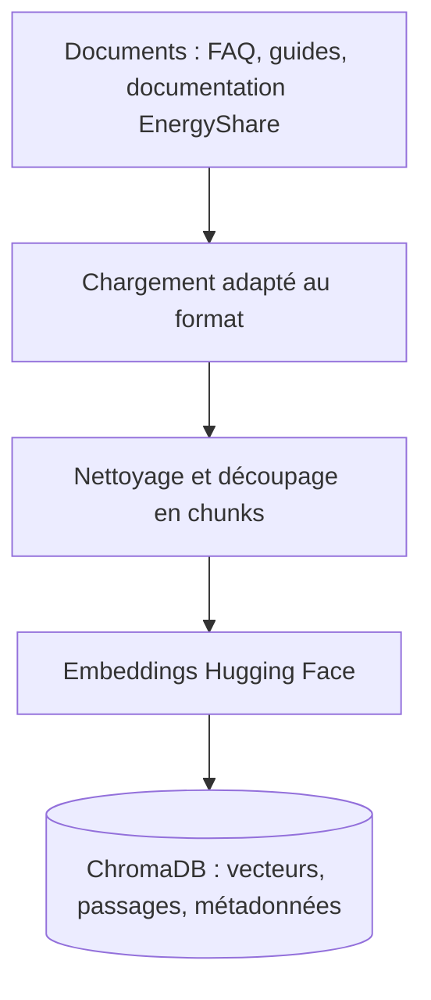

# Microservice 5 — EnergyShare RAG Assistant
## Conception des données métier : MySQL + ChromaDB

> **Statut :** modèle de conception, à adapter aux classes SQLAlchemy / migrations et au schéma ChromaDB réellement retenus.  
> **Principe :** le microservice RAG est propriétaire de **MySQL** (conversations) et **ChromaDB** (index documentaire). Les identités restent centralisées dans **Keycloak**.

## 1. Responsabilités des stockages

| Technologie | Données | Finalité |
|---|---|---|
| **MySQL** | `Conversation`, `Message`, références d'utilisateurs et métadonnées utiles | Historique des échanges, continuité conversationnelle et contrôle d'accès |
| **ChromaDB** | Textes des chunks, embeddings et métadonnées des sources | Recherche sémantique lors du RAG |
| **Keycloak** (externe) | Comptes, secrets, authentification | Source de vérité de l'identité, hors MySQL RAG |

Un `ownerUserId` contient une **référence** à l'identifiant de l'utilisateur authentifié, pas un mot de passe ni un compte dupliqué.

## 2. Entités MySQL proposées

### 2.1 `Conversation`

| Attribut | Type logique | Contrainte | Description |
|---|---|---|---|
| `id` | `VARCHAR(64)` | PK | Identifiant technique |
| `ownerUserId` | `VARCHAR(128)` | NOT NULL, index | Référence Keycloak (subject / `sub`) |
| `title` | `VARCHAR(255)` | NULL | Titre généré ou saisi |
| `createdAt` | `DATETIME(6)` | NOT NULL | Création |
| `updatedAt` | `DATETIME(6)` | NOT NULL | Dernière mise à jour |

### 2.2 `Message`

| Attribut | Type logique | Contrainte | Description |
|---|---|---|---|
| `id` | `VARCHAR(64)` | PK | Identifiant technique |
| `conversationId` | `VARCHAR(64)` | FK, index | Conversation parente |
| `role` | `VARCHAR(16)` | NOT NULL | `user` ou `assistant` |
| `content` | `LONGTEXT` | NOT NULL | Texte d'un message |
| `createdAt` | `DATETIME(6)` | NOT NULL | Date de création |

**Relation :** une `Conversation` possède `0..*` `Message` ; chaque `Message` appartient à une seule `Conversation`.

### 2.3 Métadonnées de sources (évolution possible)

Si l'application veut afficher les sources pour **chaque réponse sauvegardée**, ajouter `MessageSource(id, messageId, documentId, title, section, chunkId)`. Ce tableau est **optionnel** et doit éviter les copies inutiles de contenu documentaire.

## 3. Modèle ChromaDB

### 3.1 Collection vectorielle

Collection proposée : `energyshare_knowledge`.

Chaque enregistrement contient :

| Champ | Exemple | Description |
|---|---|---|
| `id` | `guide-solaire#chunk-004` | Identifiant stable du chunk |
| `document` | `Décaler certains usages...` | Texte du passage |
| `embedding` | `[0.11, -0.04, ...]` | Vecteur créé par le modèle d'embeddings |
| `metadata.document_id` | `guide-solaire` | Référence de document |
| `metadata.title` | `Guide solaire` | Titre |
| `metadata.section` | `Autoconsommation` | Section / source |
| `metadata.source` | `guides/solaire.txt` | Origine contrôlée |

La **dimension** des vecteurs dépend du modèle sélectionné. L'option présentée dans le projet est **Hugging Face `all-MiniLM-L6-v2`** ; l'ingestion et les requêtes doivent utiliser le **même modèle d'embeddings et la même normalisation**.

### 3.2 Ingestion documentaire

Processus : sélectionner des documents autorisés, extraire le texte, découper avec `RecursiveCharacterTextSplitter`, indexer les chunks et stocker leurs métadonnées. Utiliser un chargeur adapté aux PDF : `TextLoader` ne lit pas tous les formats.

### 3.3 Lecture au moment d'une question

1. Vectoriser la question (même modèle d'embeddings).
2. Rechercher les passages les plus pertinents dans ChromaDB.
3. Construire un prompt LangChain avec question, passages et historique autorisé.
4. Interroger Llama 3 via Ollama (si déployé).
5. Retourner réponse et références documentaires à React via Flask / Gateway.
6. Persister la conversation et les messages dans MySQL.

## 4. Règles métier et sécurité

- Chaque requête portant sur une conversation vérifie `owner_user_id` sur la base de l'identité Keycloak authentifiée.
- Ne jamais faire confiance à un `ownerUserId` envoyé dans le JSON par le navigateur.
- Ne stocker **aucun mot de passe Keycloak** dans MySQL.
- Définir une politique de conservation / suppression de l'historique des conversations.
- Les documents sont importés par des comptes autorisés ; vérifier format, taille, contenu et droits.
- Ne pas indexer des données privées d'utilisateur sans besoin explicite et protections adaptées.
- Prévenir les injections de prompt venant des documents : les passages retrouvés constituent des **données non fiables**, non des instructions système.
- Les références renvoyées doivent correspondre à des passages effectivement récupérés.
- Une absence de preuve documentaire doit déclencher une réponse prudente plutôt qu'une information inventée.
- Prévoir des sauvegardes indépendantes pour MySQL et pour ChromaDB, en respectant la version du modèle d'embeddings.

## 5. Tests de conception

| Test | Attendu |
|---|---|
| Suppression d'une conversation | Messages enfants supprimés en cascade |
| Accès à la conversation d'un autre utilisateur | Refus d'accès |
| Deux documents possèdent des titres identiques | `document_id` / `chunk_id` uniques et stables |
| Réindexation d'un document mis à jour | Anciens chunks remplacés sans doublons |
| Question sans passages suffisamment pertinents | Réponse de repli plutôt qu'une fausse citation |
| Modèle d'embeddings modifié | Réindexation ou collection séparée |

## 6. Frontières avec les autres microservices

Le RAG ne lit pas directement les bases PostgreSQL de Household, Monitoring ou Transaction ni la base MongoDB de Marketplace. La connaissance documentaire peut expliquer les mécanismes de la plateforme, mais n'est pas un registre d'offres ni une source de vérité des échanges.

Voir aussi [`api-contracts.md`](api-contracts.md) et [`rag-architecture.md`](rag-architecture.md).
