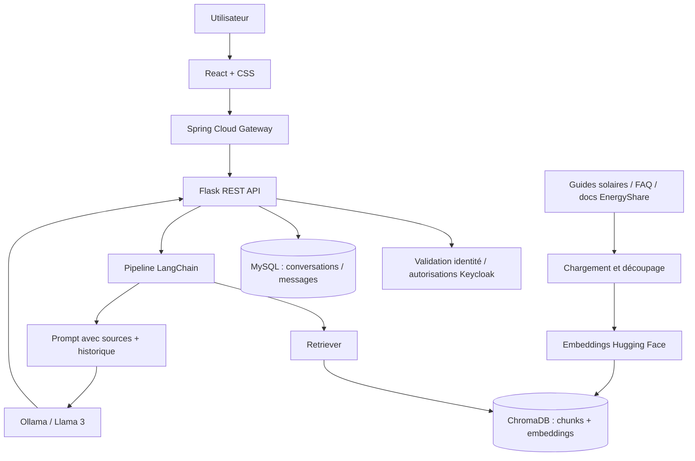

# Microservice 5 — EnergyShare RAG Assistant
## Architecture fonctionnelle et technique du pipeline RAG

> **Contexte :** l'assistant spécialisé du projet EnergyShare utilise Python/Flask, LangChain, les embeddings Hugging Face, ChromaDB, MySQL et un LLM accessible avec Ollama (Llama 3 selon la présentation). Les composants ci-dessous sont l'architecture **cible**, pas une attestation de leur déploiement actuel.

## 1. Positionnement

Le RAG Assistant aide les utilisateurs à comprendre l'énergie solaire, les pratiques d'autoconsommation, les échanges énergétiques **simulés** et le fonctionnement d'EnergyShare. Les réponses exploitent des **documents de référence** et incluent si possible leurs sources. Le service n'effectue ni calcul de surplus, ni prédiction énergétique, ni matching d'offres, ni paiement.

## 2. Fonctions principales

1. **Chat conversationnel** : questions-réponses dans l'interface React.
2. **Recherche documentaire RAG** : passages tirés de guides, FAQ et documentation EnergyShare.
3. **Conseils généraux d'optimisation** : bonnes pratiques fondées sur les documents disponibles.
4. **Mémoire conversationnelle** : contexte des questions de suivi et historique MySQL.
5. **Administration documentaire** : ingestion et mise à jour de documents autorisés (fonction à sécuriser).

## 3. Architecture logique



**Routage :** Flask utilise une URL de service configurée au niveau du Gateway, et n'a pas besoin d'un enregistrement Eureka natif. Le Gateway ne remplace pas les vérifications de droits dans Flask.

## 4. Deux flux distincts

### 4.1 Flux d'indexation documentaire

1. Un administrateur autorisé fournit un document de confiance.
2. Un loader adapté extrait son texte (`TextLoader` pour texte ; loader PDF pour PDF).
3. `RecursiveCharacterTextSplitter` produit des chunks de tailles raisonnables avec recouvrement éventuel.
4. Le modèle `all-MiniLM-L6-v2` transforme chaque chunk en embedding.
5. ChromaDB stocke les passages, vecteurs et métadonnées (`source`, `title`, `documentId`, etc.).
6. Les réindexations gèrent les mises à jour et suppressions afin d'éviter les doublons.

### 4.2 Flux de chat

1. React envoie une question à `POST /api/ai/chat` via Gateway.
2. Flask identifie l'utilisateur et vérifie l'accès à la conversation demandée.
3. Flask lit l'historique utile dans MySQL.
4. LangChain retrouve les passages ChromaDB les plus pertinents.
5. Le prompt associe les passages, la question et le contexte conversationnel ; les documents récupérés sont traités comme **données**, non comme commandes.
6. Le LLM (Ollama / Llama 3) génère une réponse dont les références doivent correspondre à des documents récupérés.
7. Flask stocke les échanges dans MySQL et renvoie texte + sources à React.

## 5. Organisation Python suggérée

```text
rag-assistant-service/
├── app/
│   ├── __init__.py
│   ├── routes/
│   │   ├── chat_routes.py
│   │   ├── conversation_routes.py
│   │   └── document_routes.py
│   ├── services/
│   │   ├── rag_service.py
│   │   ├── ingestion_service.py
│   │   └── conversation_service.py
│   ├── models/
│   │   ├── conversation.py
│   │   └── message.py
│   └── security/
│       └── jwt_validation.py
├── knowledge_base/
├── tests/
├── requirements.txt
├── Dockerfile
└── README.md
```

Cette arborescence est une **proposition** et non une structure imposée.

## 6. Technologies

| Composant | Choix | Utilisation |
|---|---|---|
| Frontend | React + CSS | Chat UI |
| Entrée réseau | Spring Cloud Gateway | Routage / contrôles transversaux |
| Service métier IA | Python + Flask | REST et orchestration |
| LangChain | Chaînes / retriever / prompts | Flux RAG et conversationnel |
| Embeddings | Hugging Face `all-MiniLM-L6-v2` | Vectorisation des passages et questions |
| Index | ChromaDB | Recherche sémantique |
| Conversations | MySQL | Historique persistant |
| LLM | Ollama + Llama 3 | Génération selon ressources disponibles |
| Identité | Keycloak | Authentification et rôles |

**Compatibilité LangChain :** certaines classes historiques (`ConversationalRetrievalChain`, `ConversationBufferMemory`) figurent dans la présentation, mais les interfaces évoluent selon les versions. Vérifier les versions installées et privilégier un assemblage compatible avec le projet avant d'implémenter.

## 7. Résilience et limites

- Timeouts raisonnables pour le LLM et la recherche vectorielle ; réponse explicite si indisponibilité.
- Limitation de taille des prompts et des historiques pour maîtriser les ressources.
- Réponses prudentes quand la base documentaire ne contient pas la réponse.
- Les sources et citations doivent être rattachées aux passages réellement utilisés.
- Protection des conversations : contrôle d'accès par propriétaire, journalisation minimale, pas de secrets dans les logs.
- Qualité des documents : origine vérifiée, mises à jour suivies et mécanisme d'invalidation des anciens chunks.
- Les conseils sont généraux et ne remplacent ni un diagnostic électrique ni des obligations réglementaires.

## 8. Tests de validation proposés

| Domaine | Cas de test | Critère attendu |
|---|---|---|
| Recherche | Question présente dans FAQ | Passage approprié récupéré |
| Attribution | Réponse générée à partir d'un guide | Source précise fournie |
| Conversation | Question de suivi | Contexte précédent utilisé uniquement pour le bon utilisateur |
| Absence de preuve | Question hors documents | Réponse prudente sans invention de sources |
| Sécurité | Accès conversation d'autrui | Refus d'accès |
| Robustesse | Ollama indisponible | Erreur contrôlée / message de repli |
| Indexation | Ajout d'un document | Chunks et métadonnées consultables |
| Actualisation | Remplacement d'un guide | Anciens chunks désindexés |

## 9. Références internes

- [`api-contracts.md`](api-contracts.md) — routes proposées et codes HTTP.
- [`mysql-chromadb-business-design.md`](mysql-chromadb-business-design.md) — modèles de données et schéma SQL.
- [`events-rabbitmq.md`](events-rabbitmq.md) — décision de ne pas rendre RabbitMQ obligatoire pour le RAG.
